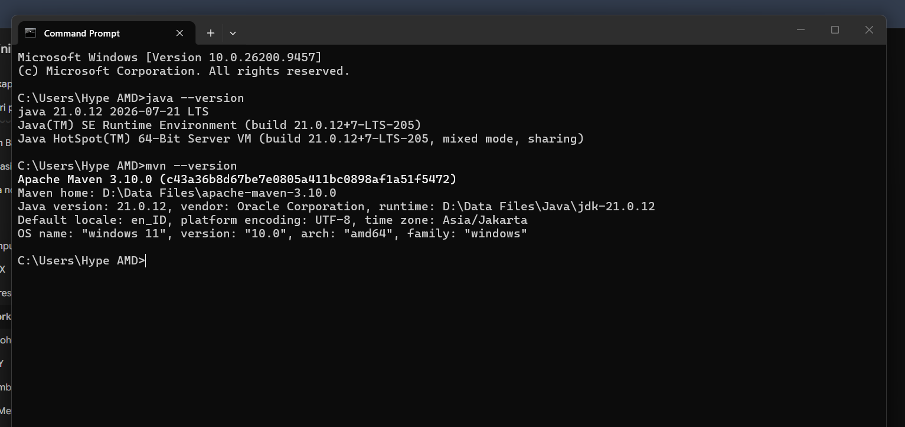
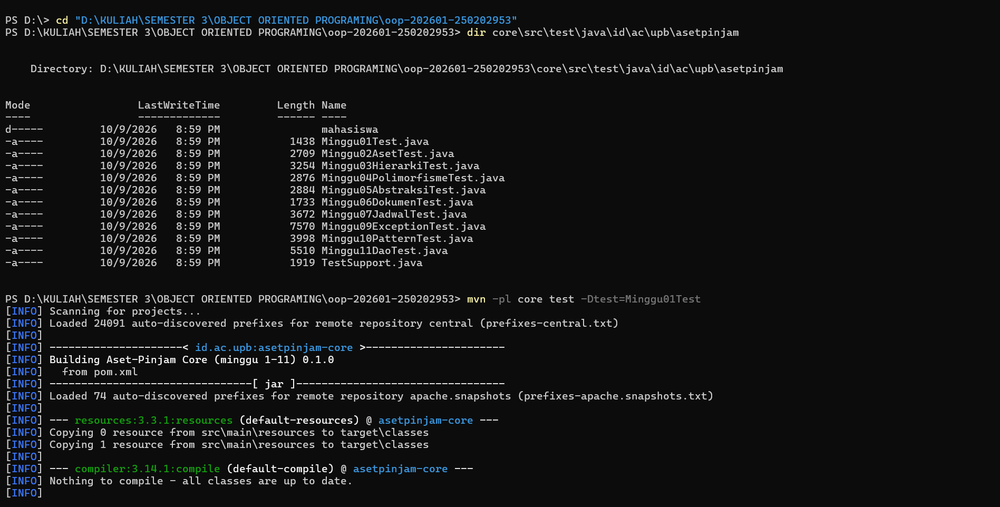
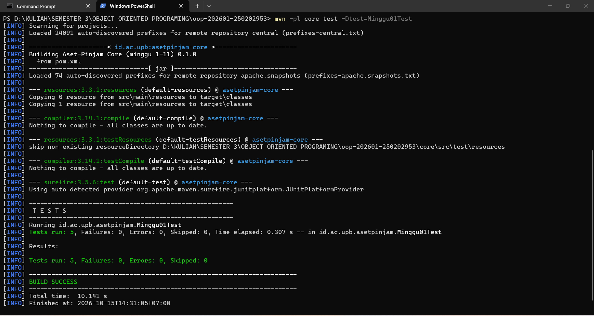

# Catatan Minggu 01: Paradigma Pemrograman dan Setup 

## Yang saya kerjakan
- Mengisi data NIM dan nama pada file `mahasiswa.properties`.
- Menyelesaikan kode program untuk tiga gaya pemrograman: Prosedural (`HelloProsedural.java`), OOP (`HelloOOP.java`), dan Fungsional (`HelloFungsional.java`).
- Menjalankan pengujian otomatis menggunakan skrip `uji.ps1`.

## Keputusan desain
- Format kalimat sapaan dibuat sama di ketiga gaya pemrograman agar hasil keluarannya konsisten

## Kendala
- Pengujian awal di Terminal VS Code mengalami error izin eksekusi skrip, yang kemudian diatasi menggunakan perintah bypass. Pengujian juga dicoba melalui Command Prompt (CMD) hingga seluruh tes berhasil.

## Penggunaan AI
- Alat yang dipakai: Gemini
- Bagian yang dibantu AI: HelloFungsional.java, HelloOOP.java, HelloProsedural.java
- Prompt utama: Bagaimana cara mengisi file HelloFungsional.java, HelloOOP.java, HelloProsedural.java, dan cara mengujinya, jelaskan!, dan cara mengatasi eror ini bagaimana jelaskan!

- Yang saya ubah atau tolak dari saran AI, dan alasannya: Menyesuaikan kembali format kode agar tetap rapi dan sesuai dengan kerangka bawaan proyek.
- Satu hal yang saya pahami lebih baik sekarang:Perbedaan penerapan konsep prosedural, OOP, dan fungsional pada bahasa Java.

## Dokumentasi

### 1. instal environment

### 2. uji test
 
