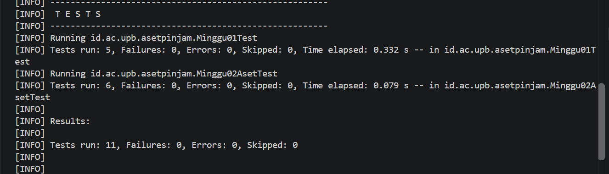
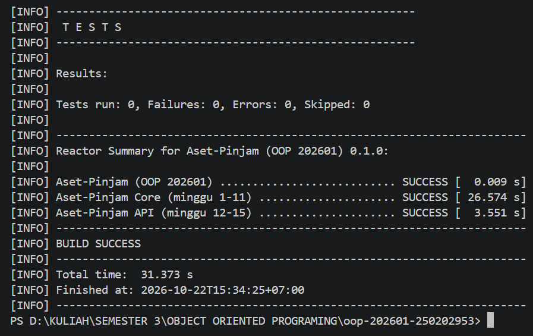

# Catatan Minggu 02: Struktur OOP: Class, Object, Encapsulation

## Yang saya kerjakan
Saya melengkapi class Aset di core/src/main/java/id/ac/upb/asetpinjam/model/Aset.java. Kode dan nama ditolak jika null atau kosong dengan IllegalArgumentException, sedangkan setStatus dan setKondisi menolak null.
Nilai awal status TERSEDIA dan kondisi BAIK, dan kode tidak punya setter. Hasil tes: Minggu02AsetTest 6 tes lulus (total 11 bersama Minggu01Test).

## Keputusan desain
- Kode dan nama disimpan sesuai input pengguna. Saya tidak memakai trim (buang spasi) dan tidak memakai toUpperCase (ubah ke huruf besar), jadi yang dimasukkan pengguna itu yang disimpan.
- Kode dan nama tidak boleh kosong. Kalau isinya null, kosong, atau hanya spasi, program memunculkan IllegalArgumentException. Pengecekan null saya tulis lebih dulu supaya program tidak mengalami error yang lain. Aturan yang sama dipakai di setNama, sedangkan setStatus dan setKondisi menolak null.
- Kode tidak punya setter. Field kode bersifat private dan tidak ada method setKode, jadi kode hanya diisi sekali saat objek dibuat dan setelah itu hanya bisa dibaca lewat getKode. Saya tidak memakai final.

## Kendala
1. Skrip PowerShell tidak bisa dijalankan, saat menjalankan .\scripts\uji.ps1, muncul error bahwa menjalankan skrip dinonaktifkan di komputer saya. Penyebabnya pengaturan keamanan PowerShell (Execution Policy). Saya mengatasinya dengan perintah Set-ExecutionPolicy -Scope Process -ExecutionPolicy Bypass, yang hanya berlaku di terminal yang sedang dibuka, lalu skripnya bisa jalan.
2. Tes minggu 2 tidak muncul, waktu pertama dijalankan, yang tampil hanya tes minggu 1. Ternyata skrip secara default hanya menjalankan minggu 1. Setelah saya tambahkan angka 2 di belakangnya (.\scripts\uji.ps1 2), tes minggu 2 ikut jalan. Saya juga jadi tahu bahwa skrip ini menjalankan tes dari minggu 1 sampai minggu yang diminta, jadi tes minggu 1 tetap ikut.

## Penggunaan AI
- Alat yang dipakai: Claude
- Bagian yang dibantu AI:  class Aset, serta cara menjalankan tes dan   mengatasi error saat dites.
- Prompt utama: 
    1. Jelaskan tugas minggu 2 ini dan cara pengerjaannya.
    2. Bagian mana saja yang perlu diisi pada class Aset ini? Tolong jelaskan juga fungsi tiap kodenya apa.
    3. Kenapa error saat dijalankan?, dan kenapa yang muncul cuma tes minggu 1?
- Yang saya ubah atau tolak dari saran AI, dan alasannya:
AI menyarankan kode dibuat final, tetapi saya tidak memakainya dan cukup tidak membuat setKode(). AI juga menyarankan `trim()`, tetapi saya menghapusnya agar nama dan kode disimpan sesuai input pengguna. Nilai awal status dan kondisi yang semula ada di konstruktor saya pindahkan ke deklarasi field agar lebih ringkas. Nama enum KondisiAset yang diasumsikan AI saya koreksi menjadi Kondisi
- Satu hal yang saya pahami lebih baik sekarang: encapsulation, Field dibuat private supaya tidak bisa diubah langsung dari luar class, jadi data hanya bisa berubah lewat setter yang mengecek nilainya dulu.

## Dokumentasi

