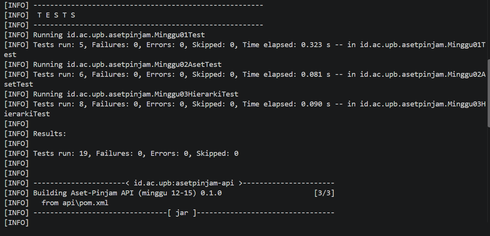
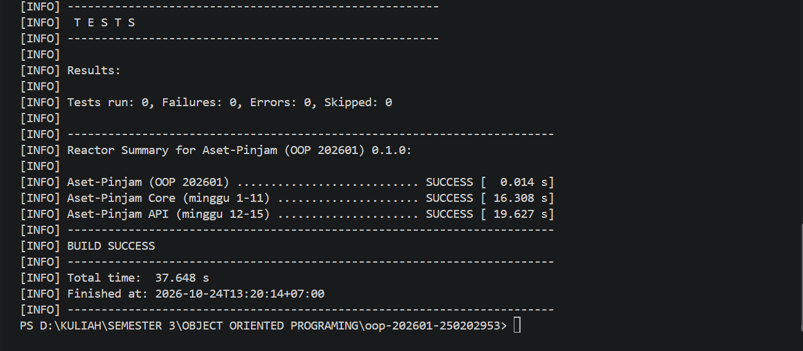

# Catatan Minggu 03: Inheritance

## Yang saya kerjakan
Minggu ini saya mengisi tiga class turunan dari Aset, yaitu Ruang, Laptop, dan AlatLab. Masing-masing saya beri field sendiri, konstruktor yang memanggil super, getter, dan getJenis. Di tiap konstruktor saya tambahkan validasi sesuai aturan tugas, misalnya kapasitas ruang harus lebih dari 0. Setelah dijalankan, semua tes lulus (19 tes, termasuk tes minggu 1 dan 2).

## Keputusan desain
- Field yang dipakai semua aset (kode, nama, status, kondisi) tetap di Aset. Field yang cuma dimiliki satu jenis saya taruh di subclass-nya, kapasitas di Ruang, spesifikasi dan nomorInventaris di Laptop, laboratorium dan tingkatRisiko di AlatLab. Soalnya laptop tidak punya kapasitas, dan ruang tidak punya spesifikasi.
- Di setiap konstruktor saya panggil super(kode, nama) di baris pertama, jadi validasi kode dan nama dari Aset ikut berlaku. Saya tidak perlu menulis ulang validasinya.
- Untuk validasi, angka saya cek rentangnya, String saya cek null lalu isBlank, dan enum cukup saya cek null.
- getJenis di Aset saya biarkan, yang saya isi getJenis di tiap subclass pakai @Override.

## Kendala
- Saat pertama dijalankan, skrip uji.ps1 ditolak PowerShell karena Execution Policy, sama seperti minggu lalu. Saya jalankan lagi Set-ExecutionPolicy -Scope Process -ExecutionPolicy Bypass, lalu skripnya bisa berjalan.
- Muncul error, yaitu method does not override or implement a method from a supertype, di Ruang, Laptop, dan AlatLab. Awalnya saya bingung karena getJenis di Aset sudah ada. Setelah dicek, penyebabnya nama method di class turunan saya tulis getJenisAset, padahal di Aset namanya getJenis. Setelah namanya saya samakan, error hilang dan semua tes lulus.

## Penggunaan AI
- Alat yang dipakai: Claude
- Bagian yang dibantu AI:  Ruang, Laptop, dan AlatLab, dan serta mencari penyebab error saat di tes.
- Prompt utama: 
    - Tolong jelaskan apa yang dimaksud dari tugas minggu 3, berperanlah sebagai seorang pembimbing, dan jelaskan dengan bahasa yang mudah dipahami.
    - Kenapa error saat dijalankan dan bagaimana cara mengatasinya?
- Yang saya ubah atau tolak dari saran AI, dan alasannya: Tidak banyak yang saya ubah karena kode dari AI sudah sesuai aturan tugas. Perubahan yang saya buat hanya di bagian @Override, yaitu nama method yang sempat salah (getJenisAset) saya ganti jadi getJenis supaya sama dengan yang ada di Aset agar tidak eror saat di uji.
- Satu hal yang saya pahami lebih baik sekarang: nama method yang di override harus sama persis dengan yang ada di Aset. Waktu saya salah tulis jadi getJenisAset dan langsung error, setelah saya samakan jadi getJenis baru bisa jalan.
    
## Dokumentasi

