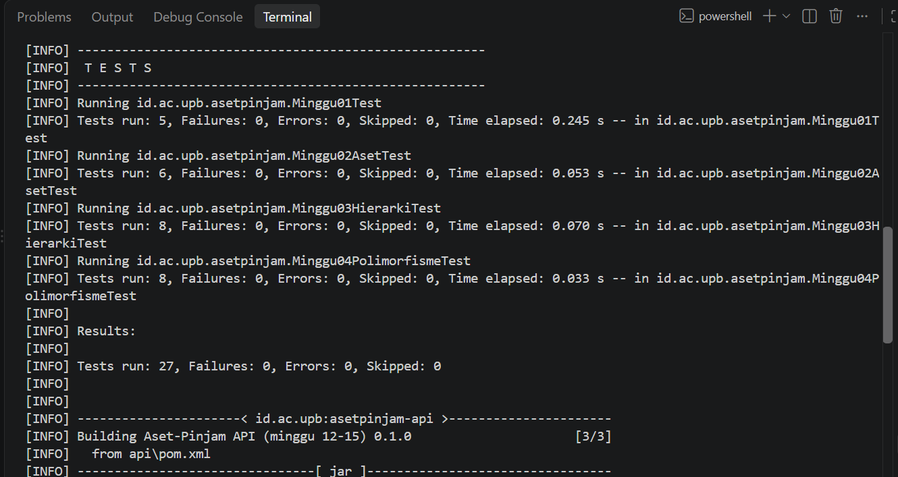
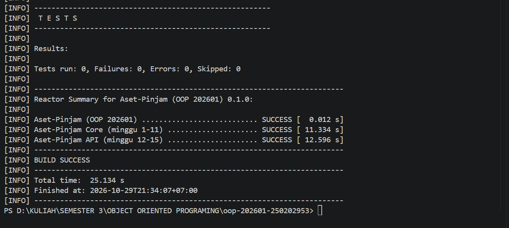

# Catatan Minggu 04: Polymorphism

## Yang saya kerjakan

Minggu ini saya mengisi hitungDenda di Aset, lalu menyesuaikannya di Ruang, Laptop, dan AlatLab dengan multiplier 1x, 2x, dan 4x. Di KatalogAset saya membuat dua method cari, yaitu cari(kata) dan cari(kata, jenis). Setelah dijalankan, semua tes lulus.

## Keputusan desain

- Pengecekan hari negatif dan rumus hari x tarif saya tulis sekali di Aset.hitungDenda, jadi tidak diulang di tiap subclass. Ruang, Laptop, dan AlatLab cukup memanggil super.hitungDenda lalu mengalikannya dengan multiplier masing-masing (1, 2, dan 4).
- Tarif dasar saya baca dari Varian.aktif().dendaPerHari, tidak saya tulis angkanya langsung, supaya kode ikut berubah kalau variannya berbeda.
- Di KatalogAset, cari(kata, jenis) saya buat memanggil cari(kata) lalu menyaring jenisnya, jadi logika pencarian tidak ditulis dua kali.
- Pencocokan atau mencari nama memakai toLowerCase di nama dan kata, lalu contains, supaya tidak membedakan huruf besar atau kecil.

## Kendala

Kendala yang saya alami adalah kesalahan pada kode, seperti kurangnya kurung kurawal penutup pada kelas Ruang, belum adanya perintah return hasil pada method pencarian di KatalogAset, dan import kelas Varian yang belum ditambahkan pada Aset. Saya mengatasinya dengan memeriksa pesan error dari terminal, memperbaiki bagian kode yang bermasalah, lalu menjalankan pengujian kembali sampai semua tes berhasil.

## Penggunaan AI

- Alat yang dipakai: claude dan GPT
- Bagian yang dibantu AI: Aset, Ruang, Laptop, AlatLab, dan KatalogAset.
- Prompt utama:
  - Tolong jelaskan apa yang dimaksud dari tugas minggu 4, berperanlah sebagai seorang pembimbing, dan jelaskan dengan bahasa yang mudah dipahami
  - Bantu periksa kode Java saya dan jelaskan bagian yang menyebabkan error
  - Tunjukkan bagian kode yang perlu diperbaiki agar pengujian minggu ke 4 berhasil.
  - Jelaskan penerapan overriding dan overloading dengan bahasa yang mudah dipahami.
- Yang saya ubah atau tolak dari saran AI, dan alasannya: Tidak banyak kode yang saya ubah. Saya juga tidak langsung mengikuti semua saran AI, tetapi memeriksanya terlebih dahulu dan hanya memperbaiki bagian yang mengalami error agar sesuai dengan ketentuan tugas.
- Satu hal yang saya pahami lebih baik sekarang: Saya jadi lebih paham cara kerja overriding dan overloading serta penggunaannya dalam kode Java.

## Dokumentasi

