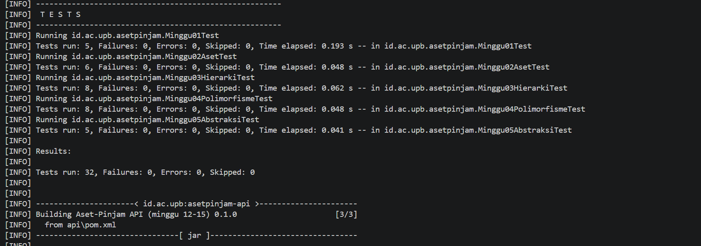
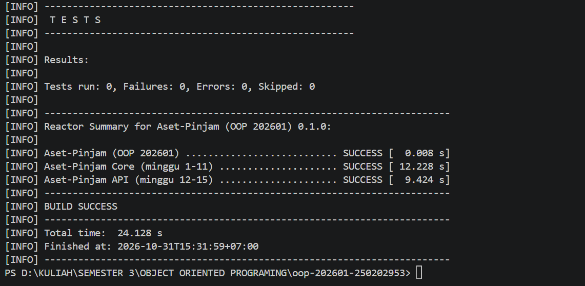

# Catatan Minggu 05: Abstraction

## Yang saya kerjakan

Minggu ini saya mengubah Aset menjadi abstract class agar hanya laptop, alat lab, dan ruang yang bisa dibuat. Saya juga mengatur peminjaman dan denda di setiap subclass, serta membuat DendaFlat dan DendaProgresif untuk menghitung denda dengan dua cara berbeda.

## Keputusan desain

- Aset saya jadikan abstract class karena laptop, alat lab, dan ruang punya data yang sama, yaitu kode, nama, status, dan kondisi. Jadi semuanya cukup mewarisi dari Aset.
- hitungDenda di Aset saya jadikan abstrak, jadi denda dihitung di tiap subclass (Laptop x2, AlatLab x4, Ruang x1), DendaProgresif tinggal memanggil aset.hitungDenda(hariTerlambat), jadi otomatis memakai denda sesuai jenis asetnya.
- DapatDipinjam dan AturanDenda saya jadikan interface karena isinya cuma aturan yang harus diikuti, tanpa menyimpan data.
- Aset hanya bisa dipinjam kalau statusnya tersedia dan kondisinya tidak rusak berat.
- DendaFlat tinggal memakai hitungan denda dari asetnya sendiri.
- Untuk DendaProgresif, rumus saya: flat + (flat x hari terlambat / 10). Artinya, makin lama terlambat, dendanya makin besar. Setiap 10 hari, tambahannya naik sebesar satu kali denda biasa.

## Kendala

- Compile error karena kurung kurawal kurang dan kelebihan di Laptop dan DendaProgresif. Saya mengatasinya dengan menghitung pasangan { dan }.
- Setelah hitungDenda di Aset abstrak, super.hitungDenda(...) di subclass error. Saya pindahkan logikanya ke tiap subclass.
- Error cannot find symbol: Varian karena subclass belum meng-import Varian. Saya tambahkan importnya.
- Error is not abstract karena saya lupa menambah kata abstract di deklarasi kelas Aset.

## Penggunaan AI

- Alat yang dipakai: Claude
- Bagian yang dibantu AI: Aset.java, DendaFlat.java, DendaProgresif.java
- Prompt utama:
  - berperanlah sebagai seorang pembimbing, jelaskan apa yang di maksud dengan tugas minggu 5, jelaskan setiap langkah pengerjaanya, gunakan dengan bahasa yang mudah di pahami dan sesuai dengan aturan tugas
  - jelaskan apa yang dimaksud dengan abstract class dan interface jelaskan fungsinya juga.
  - Carikan penyebab erornya dan jelaskan cara mengatasinya
- Yang saya ubah atau tolak dari saran AI, dan alasannya: Tidak banyak yang saya ubah, tapi saya menolak dua rumus progresif yang disarankan (persentase setelah hari ke-7 dan denda bertingkat) karena kurang pas, lalu memilih rumus sendiri yang lebih sederhana. Pembagi saya buat jadi 10 agar denda naik lebih cepat tiap 10 hari.
- Satu hal yang saya pahami lebih baik sekarang: saya jadi tahu apa itu abstraksi

## Dokumentasi

