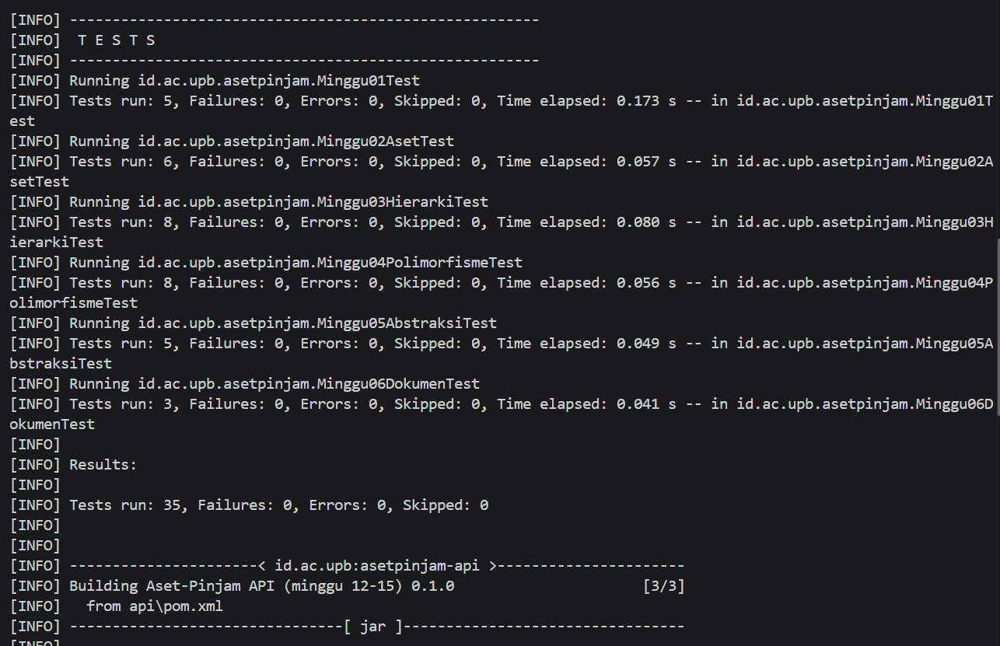
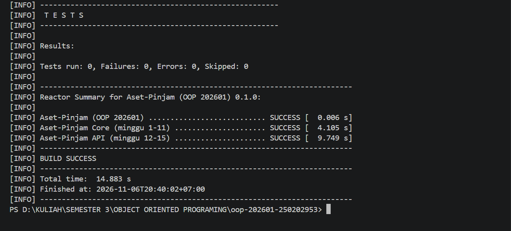

# Catatan Minggu 06: UML dan SOLID

## Yang saya kerjakan
Pada minggu keenam ini, saya mengerjakan dokumentasi UML dan penerapan prinsip SOLID pada program peminjaman aset. Saya membuat Class Diagram untuk menggambarkan struktur kelas, atribut, method, serta hubungan antarclass yang ada di dalam program. Saya juga membuat Sequence Diagram untuk menggambarkan proses pengajuan peminjaman dalam kondisi berhasil maupun terjadi bentrok jadwal. Dalam pembuatan kedua diagram tersebut, saya menggunakan Draw.io

## Keputusan desain
Dalam pengerjaan ini, saya memutuskan untuk membuat diagram berdasarkan struktur kode yang sudah ada, bukan membuat desain baru yang berbeda dari program. Hal ini dilakukan agar Class Diagram dan Sequence Diagram sesuai dengan implementasi program sebenarnya. Untuk prinsip SOLID, saya memilih dua prinsip yang sesuai dengan struktur kode dan dapat ditunjukkan melalui kelas yang sudah dibuat.

## Kendala
Kendala yang saya alami adalah memahami hubungan antarclass dan menentukan bagaimana menggambarkannya ke dalam Class Diagram. Saya juga sempat kesulitan memahami alur Sequence Diagram, terutama dalam menggambarkan kondisi pengajuan berhasil dan pengajuan yang mengalami bentrok. Untuk mengatasinya, saya mempelajari kembali struktur kode, menggunakan bantuan AI, serta membuat dan menyesuaikan diagram menggunakan Draw.io.

## Penggunaan AI
- Alat yang dipakai: claude
- Bagian yang dibantu AI: Membantu memahami materi UML, langkah pembuatan diagram, dan analisis prinsip SOLID.
- Prompt utama: 
  - berperanlah sebagai seorang pembimbing, jelaskan apa yang di maksud dengan tugas minggu 6, jelaskan setiap langkah pengerjaanya, gunakan dengan bahasa yang mudah di pahami dan sesuai dengan aturan tugas
  - Jelaskan apa yang dimaksud dengan class diagram dan sequence diagram menggunakan bahasa yang mudah dipahami, serta apa fungsi dan perbedaan keduanya
  - Analisis kode program saya dan bantu tentukan minimal dua prinsip SOLID yang benar2 diterapkan. Sebutkan kelas yang menerapkannya dan jelaskan alasannya.
  - Jelaskan langkah langkah membuat Class Diagram dan Sequence.
- Yang saya ubah atau tolak dari saran AI, dan alasannya: Saya menyesuaikan hasil saran AI dengan struktur kode program saya agar diagram tidak berbeda dengan implementasi program saya. 
- Satu hal yang saya pahami lebih baik sekarang: Saya jadi lebih memahami fungsi Class Diagram dan Sequence Diagram serta penerapan prinsip SOLID dalam program.

## Dokumentasi

