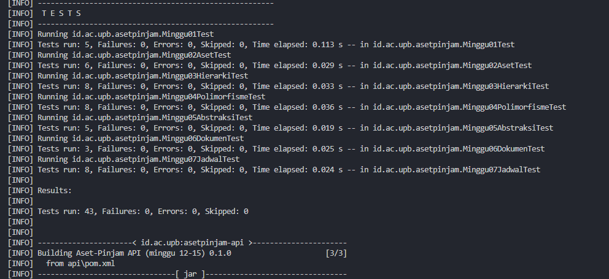
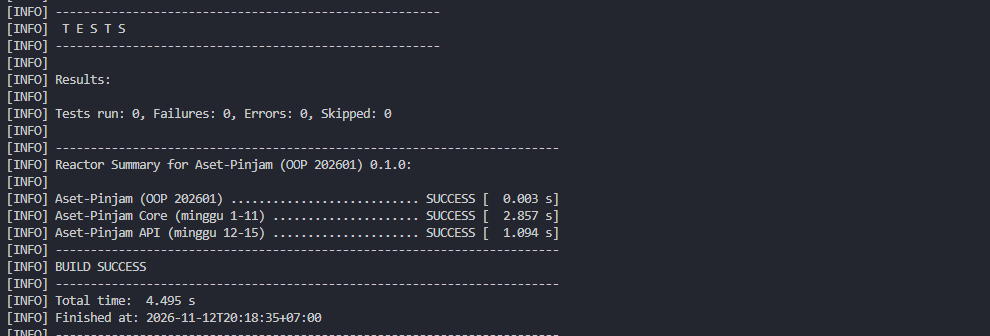
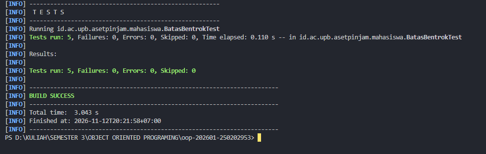

# Catatan Minggu 07: Koleksi

## Yang saya kerjakan
Minggu ini saya mengisi empat method di JadwalPeminjaman.java: bentrok, semuaUrutMulai, perAset, dan hapus. Saya juga mengisi tes BatasBentrokTest.java untuk kasus waktu selesai sama dengan waktu mulai, dan semua tes minggu 7 lulus.

## Keputusan desain
- Batas waktu: peminjaman yang selesai tepat saat peminjaman lain mulai (misalnya 09:00-11:00 lalu 11:00-13:00) tidak dianggap bentrok, supaya peminjam berikutnya bisa langsung memakai aset.
- Struktur data: saya memakai List saja. Method tambah() langsung memasukkan data ke daftar, jadi kalau ada Map kedua, datanya bisa tidak sama. Datanya juga sedikit, jadi menyaring ulang tidak masalah. Map hanya dibuat sementara di dalam perAset().

## Kendala
- Kode saya sempat merah di VS Code karena nama variabel tidak sama (urut dan salinan, map dan hasil) dan salah ketik Comparator,comparing (harusnya titik). Saya perbaiki satu per satu sampai tidak ada error.
- Saat menjalankan uji.ps1 7, tes BatasBentrokTest tidak muncul. Saya jalankan langsung dengan mvn -pl core test -Dtest=BatasBentrokTest, dan hasilnya 5 tes lulus.

## Penggunaan AI
- Alat yang dipakai: Claude
- Bagian yang dibantu AI: method bentrok, semuaUrutMulai, perAset, hapus di JadwalPeminjaman, dan isi BatasBentrokTest
- Prompt utama: 

    - berperanlah sebagai seorang pembimbing, jelaskan apa yang di maksud dengan tugas minggu 7, jelaskan setiap langkah pengerjaanya, gunakan dengan bahasa yang mudah di pahami dan sesuai dengan aturan tugas
    - jelaskan cara mengerjakan file BatasBentrokTest.java, jelaskan maksudnya gimana, fungsiny apa, gunakan bahasa yang mudah dipahami tanpa menggunkan istilah yang susah.

- Yang saya ubah atau tolak dari saran AI, dan alasannya: Tidak banyak perubahan yang saya buat.
- Satu hal yang saya pahami lebih baik sekarang: isBefore bernilai false kalau waktunya sama persis. Karena itu 11:00 dan 11:00 tidak dihitung bentrok.

## Dokumentasi

